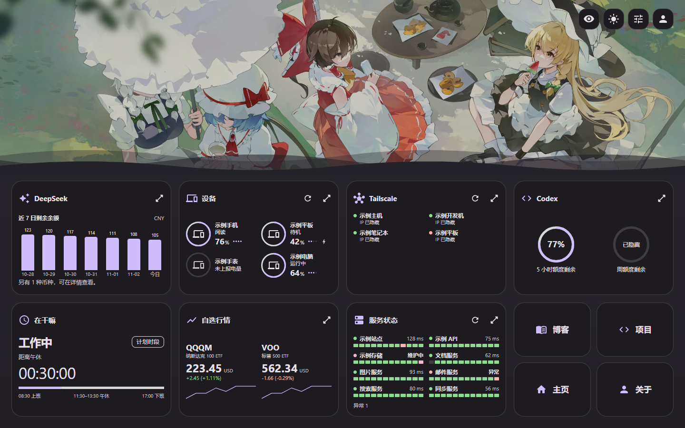
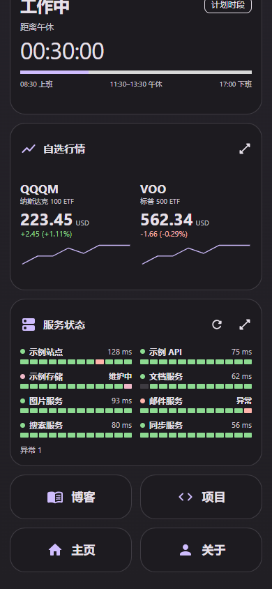
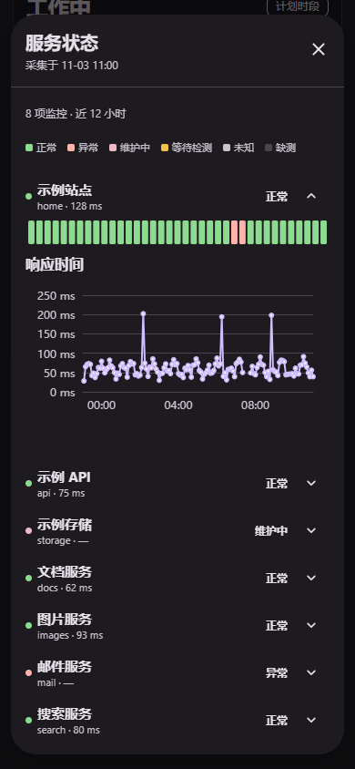
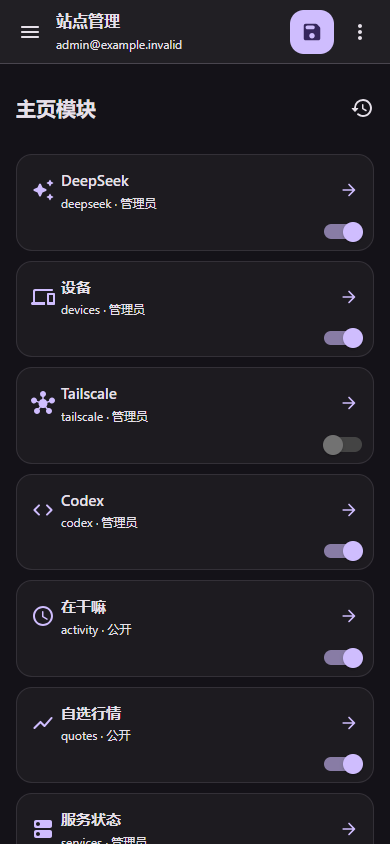

# Nozoki

Nozoki 是一个基于 [Nuxt 4](https://nuxt.com/)，以自部署和便捷管理为核心特点的个人看板。

[**在线演示**](https://nozoki.nekro.top/) | [**用户文档**](https://ayyyyano.github.io/Nozoki/)  

<table>
  <tr>
    <td></td>
    <td></td>
    <td></td>
  </tr>
</table>

## 看板功能

### 账户
- [x] **DeepSeek 余额趋势:** 当前余额与近 7 日剩余余额柱状图，可为访客模糊展示。
- [x] **Codex 额度与用量观测:** CLIProxyAPI 账户状态、定时额度查询与按日队列用量。

### 监控
- [x] **Sleepy 设备状态:** 显示 Sleepy 设备在线状态、可确认的前台应用与电量。
- [x] **Tailscale 节点状态:** 设备名称、控制面连接状态及可按登录身份隐藏的 Tailnet IP。
- [x] **UptimeFlare / Uptime Kuma 服务状态:** 定时获取对应站点的监控状态和延迟。

### 其它
- [x] **日程与倒计时:** 每周日程、多时段、模板、日期例外、倒计时和进度展示。
- [x] **自选行情:** 腾讯行情、日涨跌、成交量与近期走势图。
- [x] **常用链接:** 可自由配置外部链接跳转。

管理后台支持模块配置、来源采集和访客隐私控制。

## 快速开始

- [推荐: GitHub Actions 自动部署](https://ayyyyano.github.io/Nozoki/deploy/github-actions.html)
- [Node.js 自部署](https://ayyyyano.github.io/Nozoki/deploy/node.html)
- [Agent 快速部署](https://ayyyyano.github.io/Nozoki/deploy/agent.html)
- [Cloudflare Workers 初始化](https://ayyyyano.github.io/Nozoki/deploy/cloudflare.html)
- [Workers Builds](https://ayyyyano.github.io/Nozoki/deploy/cloudflare-builds.html)
- [本地运行](https://ayyyyano.github.io/Nozoki/deploy/local.html)

## 常见问题

详见 [故障排查](https://ayyyyano.github.io/Nozoki/operations/troubleshooting.html)。

## 参与贡献

如果你发现项目存在未解决的 Bug，欢迎提交 PR，步骤如下。

1. 创建 Fork 并克隆到本地 (`git clone https://github.com/ayyyyano/Nozoki.git`)
2. 创建一个新的分支 (`git checkout -b test`)
3. 提交更改 (`git commit -m '在此说明你的改动'`)
4. 推送到分支 (`git push origin test`)
5. 打开 PR

若涉及功能性拓展，请不要直接提交 PR，先开 Issue 探讨接入可行性。

## 许可证

项目采用 [MIT](LICENSE) 许可证。第三方许可见 [public/licenses](public/licenses/)。

## 致谢

- 灵感来源于 [Soki 的 X 帖子](https://x.com/soki_ruby/status/2113465626887094773)。
- 加载动画来自 [maimai-transition](https://github.com/gfdfdxc/maimai-transition)。
- 使用 [Vue 3](https://vuejs.org/) 和 [Nuxt 4](https://nuxt.com/) 构建。
- 主页与后台的 Material 组件来自 [Varlet](https://github.com/varletjs/varlet)。
- Material 图标来自 [Iconify](https://iconify.design/)。
- 特别感谢 [Soki](https://x.com/soki_ruby) 与 [Adrawta](https://x.com/Adrawta) 的灵感和技术支持。
